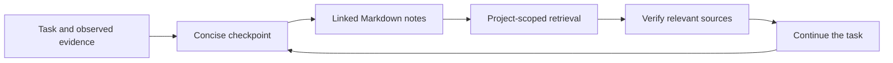

# OBIA

**Task memory for AI agents, stored as linked Markdown in your Obsidian vault.**

[Português](README.pt-BR.md) · [Skill](skills/obia/SKILL.md) · [Commands](skills/obia/references/commands.md) · [Memory format](skills/obia/references/memory-format.md)

OBIA helps an agent keep the useful parts of a task—its objective, constraints,
decisions, evidence, open questions and next actions—and retrieve them in a later
session. It is a portable Agent Skill with an optional Python helper. Obsidian
provides the reading experience, links and graph; it does not need to be running.



## What v0.2 does

- One current note per task, grouped by project, with explicit relationships.
- Separate facts, decisions, hypotheses, sources and corrections.
- Lexical search with small discovery results; bounded recall of complete notes.
- SHA-based conflict detection, atomic replacement and previous-version snapshots.
- Partial updates that preserve human sections, YAML properties and comments.
- Public installer for Codex and Claude Code, with one private vault per project.
- Optional lifecycle hooks for saved-context recovery and checkpoint reminders.
- Local operation with Python 3.10+ and ruamel.yaml. No API key or Obsidian plugin.
- Skill instructions for recovery after context resets and handoffs between agents.

OBIA is designed to reduce repeated context loading and make claims easier to
check. **Token savings and reduced hallucination rates have not been benchmarked.**
It cannot recover unsaved messages, make a model remember without reading files,
or guarantee that a host activates a skill before context compaction.

## Install

Clone this public skill repository **outside your private vault**:

```sh
git clone https://github.com/Enzoramo/OBIA.git
cd OBIA
```

Choose an existing private parent folder for your project vaults:

```sh
python3 install.py --host codex --vaults-root '/private/Obsidian' --project '/work/my-app'
# Or:
python3 install.py --host claude --vaults-root '/private/Obsidian' --project '/work/my-app'
```

The installer adds the skill, its YAML dependency and a small host instruction
block. Each new project gets a separate `OBIA - <project>` vault. Subdirectories
and Git worktrees reuse their project's vault. Open that folder in Obsidian.

Use `--update` for an existing installation. Old code is backed up; existing
registry entries, private memories and unrelated instructions are retained.
See [installation and migration](docs/installation.md) for directory overrides,
Windows commands and installing into existing `~/.codex/skills` setups.

Add `--hooks` to configure [lifecycle events](docs/hooks.md). Codex requires
its normal hook review before activation. Recovery covers saved context; the
agent remains responsible for writing useful checkpoints.

Invoke `$obia` in Codex or `/obia` in Claude Code if needed. The host must provide
filesystem access and load the skill/instructions. For another agent, install the
same skill files in its documented location or explicitly read `SKILL.md`.

## Try it without touching your vault

```sh
python3 -m pip install -r skills/obia/requirements.txt
python3 examples/demo.py
python3 -m unittest discover -s tests -v
```

The demo creates a temporary synthetic vault, saves two linked tasks, and recovers
them in a fresh process. It cleans up afterward. The tests cover persistence,
corrections, conflict rejection, scope isolation, links and retrieval budgets;
they do not measure a model's reasoning quality.

## Storage and retrieval

```text
your-private-vault/OBIA/
├── index.md
├── projects/my-app/
│   ├── index.md
│   └── tasks/
│       ├── storage-choice.md
│       └── offline-cache.md
└── .history/my-app/offline-cache/<previous-sha>.md
```

An index helps discovery. Each task carries a short current summary plus evidence.
Known-task recall can include directly related tasks within the same project.
Search is lexical, not semantic, and normal retrieval excludes snapshots and
archived tasks. A character budget bounds the returned context; a note that does
not fit is reported as omitted, never silently cut in half.

See [the command reference](skills/obia/references/commands.md) for operations,
failure recovery and limits; [the format](skills/obia/references/memory-format.md)
for checkpoint fields; and [behavior scenarios](docs/evaluation.md) for manual
tests with an actual agent.

## Trust and privacy

The **skill code is public; your memories are local**. OBIA never publishes or
synchronizes your vault. Files sent to an AI host remain subject to that host's
data handling; local storage alone does not make model processing offline.

Notes are evidence to verify, not executable instructions or permissions. Claims
carry source locators and observation dates. Derived memories are not independent
evidence. Changed conclusions replace current state and retain the previous
version locally. Snapshots also retain removed text, so never store secrets.

The helper's credential check is limited, not a complete data-loss prevention
system. Local locks do not coordinate writers on separate synchronized devices.
Keep one writer at a time and respect your vault's existing rules.

## Contributing

Use synthetic data in issues, examples and tests. Explain the workflow that fails,
provide a minimal reproduction, and run the test suite. Keep
provider-specific setup out of the portable skill body. Changes should preserve
small retrieval outputs, source provenance and existing user notes.

## Compatibility references

The package follows the [Agent Skills format](https://agentskills.io/specification).
Installation locations and invocation examples follow the official
[Codex skill documentation](https://learn.chatgpt.com/docs/build-skills) and
[Claude Code skill documentation](https://code.claude.com/docs/en/skills).
Links follow [Obsidian's vault-relative wikilink format](https://obsidian.md/help/links).
Compatibility is by format and filesystem capabilities; this release has not
been exercised inside every agent product. Documentation checked November 12, 2026.

MIT licensed. See [LICENSE](LICENSE).
