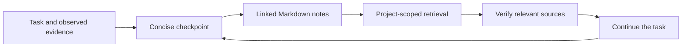

# OBIA

**Task memory for AI agents, stored as linked Markdown in your Obsidian vault.**

[Português](README.pt-BR.md) · [Skill](skills/obia/SKILL.md) · [Commands](skills/obia/references/commands.md) · [Memory format](skills/obia/references/memory-format.md)

OBIA helps an agent keep the useful parts of a task—its objective, constraints,
decisions, evidence, open questions and next actions—and retrieve them in a later
session. It is a portable Agent Skill with an optional Python helper. Obsidian
provides the reading experience, links and graph; it does not need to be running.



## What v0.2 does

- One current note per task, grouped by project, with explicit relationships.
- Separate facts, decisions, hypotheses, sources and corrections.
- Lexical search and adaptive recall: whole essential sections, details on demand.
- Snapshot-safe section/source reads, optional cited-source bundling and explicit SHA-based context reuse.
- Checkpoint readback receipts that avoid separate routine read/check calls.
- A [synchronous Codex desktop workflow](skills/obia/references/desktop.md) that bundles recovery/binding and save/ack through the existing shell tool, without changing hook configuration or trust.
- An [opt-in structured handoff adapter](skills/obia/references/handoff.md) for hosts that inject memory and persist structured model output.
- SHA-based conflict detection, atomic replacement and previous-version snapshots.
- Partial updates that preserve human sections, YAML properties and comments.
- Public installer for Codex and Claude Code, with one private vault per project.
- Optional lifecycle hooks for saved-context recovery and checkpoint reminders.
- Local operation with Python 3.10+ and ruamel.yaml. No API key or Obsidian plugin.
- Skill instructions for recovery after context resets and handoffs between agents.

OBIA is designed to reduce repeated context loading and make claims easier to
check. **General token savings and reduced hallucination rates are not established.**
The [work and token analysis](docs/economia-trabalho-tokens.md) (Portuguese)
provides local payload counts and conditional savings scenarios, not measured
end-to-end savings. The [progressive retrieval benchmark](docs/progressive-retrieval.md)
adds reproducible synthetic comparisons, including source expansion and negative results.
An [18-execution real-agent pilot](docs/real-agent-evaluation.md) measured higher
total token usage for a single CLI handoff when checkpoint creation/maintenance
were included, with all predefined functional and retention checks passing. A
[follow-up optimization and 24 measured executions](docs/economical-checkpoints.md)
reduced OBIA's inclusive scenario tokens by 35.1% and command calls by 28.9%; the
final six replay continuations passed all 16 checks and the added memory audit.
OBIA still cost about twice the baseline in this task, with checkpoint creation
included; the replay explicitly reuses the original creation/baseline evidence.
It did not test automatic context injection by lifecycle hooks.
A [36-execution integrated-adapter study](docs/integrated-handoff-evaluation.md)
then measured **16.9% fewer total tokens** in its final fresh cohort, including
checkpoint generation/maintenance, with all 16 checks and the memory audit passing.
Long histories saved 29.6%; short histories still cost 5.3% more. This requires
explicit host integration; it does not measure the default hook workflow. Higher
uncached input/output and execution duration prevent claims of financial or speed
savings. The unsuccessful first cohort and its full costs remain reported.
A [native Codex subagent study](docs/desktop-native-evaluation.md) tests the
synchronous workflow, including all planning and checkpoint costs. It reports
lower measured token usage, but the frozen quality comparison is inconclusive
because format-metadata requirements were ambiguous. A separate diagnostic does
not replace the original scores. Subagents did not exercise native Stop; daily
end-to-end savings with equal quality are **not established**.
It cannot recover unsaved messages, make a model remember without reading files,
or guarantee that a host activates a skill before context compaction.

## Install

Clone this public skill repository **outside your private vault**:

```sh
git clone https://github.com/Enzoramo/OBIA.git
cd OBIA
```

Choose an existing private parent folder for your project vaults:

```sh
python3 install.py --host codex --vaults-root '/private/Obsidian' --project '/work/my-app'
# Or:
python3 install.py --host claude --vaults-root '/private/Obsidian' --project '/work/my-app'
```

The installer adds the skill, its YAML dependency and a small host instruction
block. Each new project gets a separate `OBIA - <project>` vault. Subdirectories
and Git worktrees reuse their project's vault. Open that folder in Obsidian.

Use `--update` for an existing installation. Old code is backed up; existing
registry entries, private memories and unrelated instructions are retained.
See [installation and migration](docs/installation.md) for directory overrides,
Windows commands and installing into existing `~/.codex/skills` setups.

Add `--hooks` to configure [lifecycle events](docs/hooks.md). Codex requires
its normal hook review before activation. Recovery covers saved context; the
agent remains responsible for writing useful checkpoints.

Invoke `$obia` in Codex or `/obia` in Claude Code if needed. The host must provide
filesystem access and load the skill/instructions. For another agent, install the
same skill files in its documented location or explicitly read `SKILL.md`.

## Try it without touching your vault

```sh
python3 -m pip install -r skills/obia/requirements.txt
python3 examples/demo.py
python3 -m unittest discover -s tests -v
```

The demo creates a temporary synthetic vault, saves two linked tasks, and recovers
them in a fresh process. It cleans up afterward. The tests cover persistence,
corrections, conflict rejection, scope isolation, links and retrieval budgets;
they do not measure a model's reasoning quality.

## Storage and retrieval

```text
your-private-vault/OBIA/
├── index.md
├── projects/my-app/
│   ├── index.md
│   └── tasks/
│       ├── storage-choice.md
│       └── offline-cache.md
└── .history/my-app/offline-cache/<previous-sha>.md
```

An index helps discovery. Each task carries a short current summary plus evidence.
Known-task recall can include directly related tasks within the same project.
Search is lexical, not semantic, and normal retrieval excludes snapshots and
archived tasks. Hooks use adaptive brief retrieval, preserving whole essential
sections and exposing omitted details; short notes can be returned whole when
smaller. A character budget bounds the output. Essential content that cannot fit
requires a full read; it is never silently truncated. CLI recall defaults to full
notes for compatibility; select `--view brief` explicitly for adaptive retrieval.

See [the command reference](skills/obia/references/commands.md) for operations,
failure recovery and limits; [the format](skills/obia/references/memory-format.md)
for checkpoint fields; and [behavior scenarios](docs/evaluation.md) for manual
tests with an actual agent.

## Trust and privacy

The **skill code is public; your memories are local**. OBIA never publishes or
synchronizes your vault. Files sent to an AI host remain subject to that host's
data handling; local storage alone does not make model processing offline.

Notes are evidence to verify, not executable instructions or permissions. Claims
carry source locators and observation dates. Derived memories are not independent
evidence. Changed conclusions replace current state and retain the previous
version locally. Snapshots also retain removed text, so never store secrets.

The helper's credential check is limited, not a complete data-loss prevention
system. Local locks do not coordinate writers on separate synchronized devices.
Keep one writer at a time and respect your vault's existing rules.

## Contributing

Use synthetic data in issues, examples and tests. Explain the workflow that fails,
provide a minimal reproduction, and run the test suite. Keep
provider-specific setup out of the portable skill body. Changes should preserve
small retrieval outputs, source provenance and existing user notes.

## Compatibility references

The package follows the [Agent Skills format](https://agentskills.io/specification).
Installation locations and invocation examples follow the official
[Codex skill documentation](https://learn.chatgpt.com/docs/build-skills) and
[Claude Code skill documentation](https://code.claude.com/docs/en/skills).
Links follow [Obsidian's vault-relative wikilink format](https://obsidian.md/help/links).
Compatibility is by format and filesystem capabilities; this release has not
been exercised inside every agent product. Documentation checked November 12, 2026.

MIT licensed. See [LICENSE](LICENSE).
